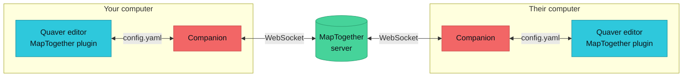

<div align="center">

<a href="https://qmtg.rhythmgamers.net"></a>

The notes, timing points and SVs you place show up in their editor, and theirs in yours.

<br>

<a href="https://steamcommunity.com/sharedfiles/filedetails/?id=3816719266"></a>
<a href="https://qmtg.rhythmgamers.net"></a>
<a href="#how-it-works"></a>

<br>

<a href="https://github.com/Adrriii/MapTogether/blob/master/package.json"></a>
<a href="LICENSE"></a>

<a href="https://github.com/Quaver/Quaver"></a>


</div>

<br>

## Features

<table>
<tr>
<td width="33%" valign="top">

### Every edit, live
Notes, long notes and mines, with their hitsounds, layer and timing group. Moving, flipping, swapping lanes, resnapping and reversing all come across.

</td>
<td width="33%" valign="top">

### Timing included
Timing points, SVs and scroll speed factors, bookmarks, timing groups and layer settings stay in sync too.

</td>
<td width="33%" valign="top">

### Undo that makes sense
Undo and redo travel like any other edit, and so do the edits other plugins make.

</td>
</tr>
<tr>
<td valign="top">

### See each other
Everyone's cursor shows up as a bookmark in their colour. Click a name to jump to where they are.

</td>
<td valign="top">

### Join with any copy
The companion finds the map on your disk and compares it with the host's. Take theirs when yours differs, or download their mapset in one click.

</td>
<td valign="top">

### Hard to break
Regular checks heal any drift, sessions survive dropped connections and server restarts, and edits made while the window was closed are merged back in.

</td>
</tr>
</table>

## Get started

1. **Subscribe** to [MapTogether on the Steam Workshop](https://steamcommunity.com/sharedfiles/filedetails/?id=3816719266).
2. **Run the companion.** Download it from [qmtg.rhythmgamers.net](https://qmtg.rhythmgamers.net) (Windows and Linux) and keep it open while you map. It opens a status window in your browser, finds your Songs folder on its own and keeps itself and the plugin up to date.
3. **Open the plugin** in the editor from `Plugins > Steam Workshop > MapTogether`.
4. **Host or join.** To host, choose *Host this map* and save with <kbd>Ctrl</kbd> + <kbd>S</kbd> when the plugin asks. To join, pick a session from the list and save when asked. The host lets you in.

> [!TIP]
> Keep a backup of any map you care about and save often.

<details>
<summary><b>Known limits</b></summary>
<br>

- Edits from other people don't mark your map as unsaved. Make a change of your own before saving, or Quaver won't write the file.
- Creating, deleting and reordering layers isn't shared yet. The plugin warns you when one of your edits wasn't sent.
- Keep the plugin window open while you map. Edits made while it's closed are merged when you reopen it, and the host's version wins where you both changed the same second of the song.
- Everyone needs the same companion version. The plugin tells you when yours is out of date.
- macOS isn't supported. The companion runs on Windows and Linux.

</details>

## How it works

Quaver plugins can't open network connections, so MapTogether comes in three parts:



| Part | Where | What it does |
|---|---|---|
| **Plugin** | [`src/plugin`](src/plugin) (Lua) | Runs inside Quaver's editor, sends your edits and applies everyone else's. |
| **Companion** | [`src/companion`](src/companion) (TypeScript) | Talks to the plugin through its `config.yaml` ([`src/quaver_ipc`](src/quaver_ipc)) and to the server over a WebSocket. Finds the map on disk, shows the status window and handles updates. |
| **Server** | [`src/server`](src/server) (TypeScript) | Orders the edits of a session, relays them, and brings late joiners up to date. |

[`src/shared`](src/shared) holds the protocol and types the companion and the server share.

## Development

You need [Bun](https://bun.sh). Clone the repository into Quaver's `Plugins` folder so Quaver picks the plugin up, then:

```bash
bun install
```

Build the plugin into `plugin.lua` and run the companion from source, rebuilding on changes:

```bash
bun run dev
```

Run your own server and point the companion at it:

```bash
bun run server
```

```bash
MT_SERVER=ws://localhost:7777 bun run dev
```

Before opening a pull request, run the checks. The end-to-end tests drive real companions and a server against a mock Quaver editor.

```bash
bun run test
```

```bash
bun run typecheck
```

```bash
bun run lint
```

<details>
<summary><b>Companion settings</b></summary>
<br>

| Variable | Effect |
|---|---|
| `MT_SERVER` | Server URL (default `wss://qmtg.rhythmgamers.net`) |
| `MT_SONGS_DIR` | Quaver `Songs` folder, when it can't be found on its own |
| `MT_NO_GUI` | Don't open the status window in the browser |
| `MT_GUI_PORT` | Port of the status window |
| `MT_NO_UPDATE` | Don't update the companion itself |
| `MT_NO_PLUGIN_UPDATE` | Don't update the plugin |

</details>

<details>
<summary><b>Hosting a server</b></summary>
<br>

```bash
docker compose -f docker/docker-compose.yml up -d
```

The server listens on port 7777 in the container, published on `MT_PORT` (default 24981). If you change the server code, the AGPL asks you to offer its source to the people who use it.

</details>

## License

Copyright (C) 2026 Adrien Boitelle

MapTogether is free software: you can redistribute it and/or modify it under the terms of the [GNU Affero General Public License](LICENSE) as published by the Free Software Foundation, either version 3 of the License, or (at your option) any later version. It is distributed in the hope that it will be useful, but WITHOUT ANY WARRANTY; without even the implied warranty of MERCHANTABILITY or FITNESS FOR A PARTICULAR PURPOSE.

`intellisense.lua` comes from Emik and plummyyummy and is in the public domain.

<br>

<div align="center">
<sub>Made for the Quaver mapping community.</sub>
</div>
